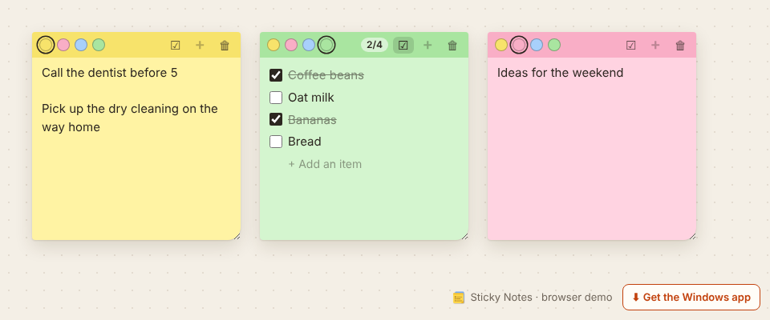
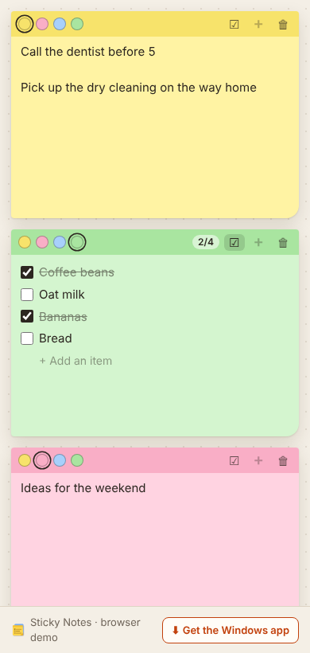

# Sticky Notes

**⬇ [Download for Windows](https://github.com/TheoYanvno/sticky-notes/releases/latest/download/Sticky-Notes-Setup.exe)** · **▶ [Try it in your browser](https://theoyanvno.github.io/sticky-notes/app/)**

Simple sticky notes for the Windows desktop. Each note sits on your screen where you put it and stays there until you delete it, even after a restart. Pick one of four colors, switch a note to a checklist, and press **+** for another note. Three notes at a time keeps the desktop tidy.

**Tech:** Electron · JavaScript (ES modules) · HTML/CSS · `node:test` · electron-builder · GitHub Actions · no frameworks

| Three notes | On a phone (browser demo) |
|---|---|
|  |  |

## Features

Every note has the same small bar across the top:

| Control | What it does |
|---|---|
| ● ● ● ● | Yellow, pink, blue or green. A new note takes a color the others aren't using |
| ☑ | Turns the note into a checklist (each line becomes an item) and back again (items become lines), so nothing typed is lost. Checked items are crossed out, with a done count like 1/3 |
| **+** | A new note, opened beside this one. Greyed out once there are three |
| 🗑 | Deletes the note. If it has anything in it, the button asks "Delete?" first |

- **No titles, no menus.** Just type
- **Stays on screen.** There's no window around it, only the note and a soft shadow on your desktop: drag it by the top bar, resize it from the grip in its bottom corner. Its spot, size, color and text are saved as you go. Quitting keeps them, and they come back when the app starts. The app starts with Windows (you can switch that off from the tray icon), so notes are there after a restart
- **Three at a time.** **+** turns off at three notes. Delete one to make room
- **Tray icon:** New note, Show my notes, Start with Windows, Quit. **Ctrl+Shift+N** makes a new note from anywhere
- **Moves between screens.** If a note was on a monitor that's been unplugged, it comes back on the main screen

## Download

**[Download Sticky-Notes-Setup.exe](https://github.com/TheoYanvno/sticky-notes/releases/latest/download/Sticky-Notes-Setup.exe)**, run it, and pick where to install. The link always points at the newest release.

The installer isn't code-signed yet, so Windows SmartScreen may ask you to confirm the first time: choose **More info → Run anyway**.

Upgrading from 1.0: your notes carry over. Titles become the first line, purple notes turn blue and orange ones yellow. If you had more than three notes, the three you edited most recently are kept.

## How it's built

| File | What it does |
|---|---|
| [`main.js`](main.js) | Electron main process: one see-through, frameless window per note (only the note shows), remembering where it's moved, the 3-note limit, tray, shortcut, start with Windows, and the data file |
| [`preload.cjs`](preload.cjs) | The only bridge between a note window and the main process: five functions exposed with `contextBridge` |
| [`src/notes.js`](src/notes.js) | The rules: four colors, the limit of three, where a new note goes, checklist on/off, items |
| [`src/storage.js`](src/storage.js) | Checks and repairs saved data, upgrades 1.0 files, and saves without ever leaving a half-written file |
| [`app/note-view.js`](app/note-view.js) | Draws one note (the bar and the text or checklist); shared by the desktop and the browser |
| [`app/note.js`](app/note.js) | The page inside each desktop note window |
| [`app/app.js`](app/app.js) | The browser demo: the same notes on a desk, dragged and resized in the page, saved in `localStorage` |
| [`test/`](test) | Unit tests for the rules and saving, plus an end-to-end test that starts the real app ([`test/smoke`](test/smoke)) |

The logic in `src/` is plain JavaScript with no Electron or browser code, so the main process, the pages and the tests all use the same rules.

**Who owns what.** The page owns what's written on a note; the window owns where it is. When a page saves, the main process only takes the text, checklist and color from it, and a window's position and size come from its own move and resize events. That way neither can overwrite the other with an old value.

**Security.** Pages run with `contextIsolation` on, `nodeIntegration` off and the sandbox enabled, under a strict Content Security Policy (scripts and styles only from the app itself). Pages can't navigate away or open windows. User text is only ever set through `.value`/`.textContent`, never as HTML.

**Saving.** Notes live in `sticky-notes.json` in the app's user-data folder (`%APPDATA%\sticky-notes`). Each save writes a temporary file, flushes it to disk, then renames it over the old one, so a crash or power cut can't leave a half-written file. The previous version is kept as `.bak`; if the main file is ever damaged, the app loads the backup and keeps the damaged copy as `.corrupt`. Saves are queued so an older one can never overwrite a newer one.

**Builds.** GitHub Actions runs the unit tests and then the end-to-end test: it starts the real Electron app under a virtual screen, types in a note, makes a checklist, presses **+** up to the limit, moves and deletes notes, and checks what was saved. Then it builds the Windows installer. A new version number in `package.json` publishes a new release.

## Run it

```bash
npm install
npm start          # run the desktop app
npm test           # unit tests for the notes and saving
npm run dist       # build the Windows installer into dist/ (run on Windows)
```

For the browser version without Electron, serve the folder (`python3 -m http.server`) and open `/app/`.

Built with help from AI coding tools for planning, code review and tests.
