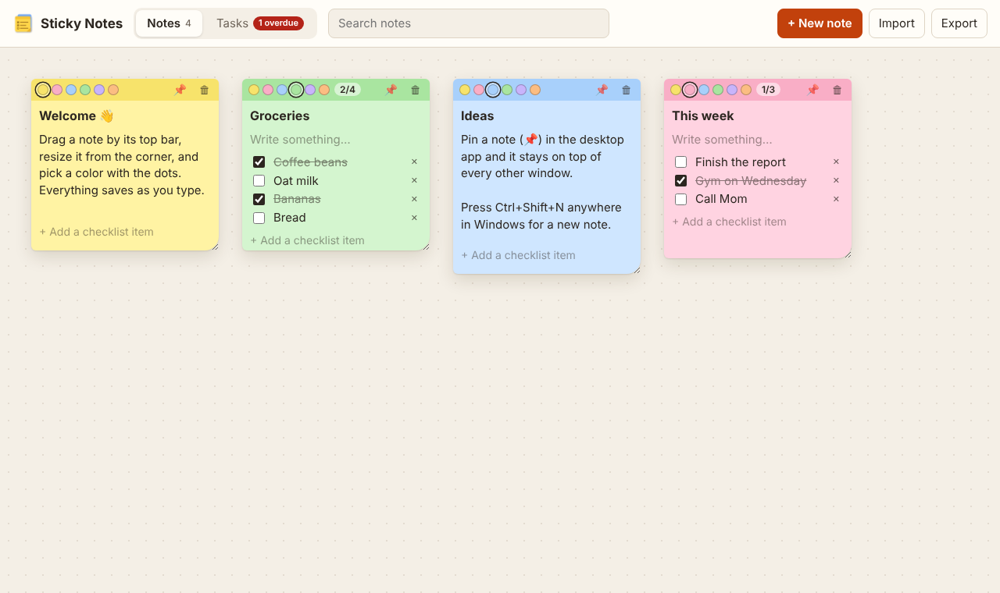
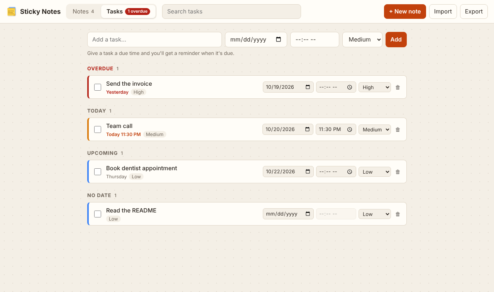

# Sticky Notes

**▶ [Try it in your browser](https://theoyanvno.github.io/sticky-notes/app/)** · **⬇ Windows installer:** built by GitHub Actions, see [Download](#download)

A Windows desktop app for sticky notes and tasks. Put colored notes anywhere on a board, turn them into checklists, pin one on top of every other window, and keep a task list with due dates, priorities and reminders.

**Tech:** Electron · JavaScript (ES modules) · HTML/CSS · `node:test` · electron-builder · GitHub Actions · no frameworks

| Notes | Tasks |
|---|---|
|  |  |

## Features

**Notes**
- Six colors, picked with the dots on each note's top bar
- Drag a note by its top bar (or focus the bar and use the arrow keys), and resize it from the corner
- Title, free text and a **checklist** with a done count (2/4); checked items are crossed out
- **Search** across titles, text and checklist items, ignoring case and accents ("cafe" finds "Café"). Press `/` to jump to the search box
- **Pin a note** (📌) into its own small window that stays on top of everything else, handy for a to-do list beside your work. Edits in the pinned window show up on the board straight away

**Tasks**
- Due date, optional due time, and high/medium/low priority
- Sorted into **Overdue, Today, Upcoming, No date and Done**, soonest first and then by priority
- Readable due labels: "Today 3:00 PM", "Tomorrow", "Friday", "2 days ago"
- **Reminders:** a Windows notification when a task with a due time comes due. Reminders still fire when the window is closed, because closing hides the app in the system tray. Change the due time and the reminder resets

**Desktop**
- **Ctrl+Shift+N** anywhere in Windows opens a new note
- **Tray icon** with Open, New note and Quit
- **Export** everything to a JSON file and **import** it again (or on another PC). An import adds to your notes rather than replacing them; when the same note is in both, the newer copy wins

## Download

Every push to `main` builds the Windows installer on GitHub Actions. Open the latest run under **Actions → Build Windows installer** and download **Sticky-Notes-Setup** from its artifacts. Tagged versions (`v1.0.0`) also get it attached to a GitHub release.

The installer isn't code-signed, so Windows SmartScreen may warn the first time: choose **More info → Run anyway**.

## How it's built

| File | What it does |
|---|---|
| [`main.js`](main.js) | Electron main process: the windows, tray, global shortcut, reminders, export/import dialogs and the data file |
| [`preload.cjs`](preload.cjs) | The only bridge between the pages and the main process: a small, fixed list of functions exposed with `contextBridge` |
| [`src/notes.js`](src/notes.js) | Notes: create, move, resize, colors, checklists, bring to front, search |
| [`src/tasks.js`](src/tasks.js) | Tasks: due dates in local time, priority, the Overdue/Today/Upcoming views, sorting and due labels |
| [`src/reminders.js`](src/reminders.js) | Which tasks are due right now, when to check next, and the notification text |
| [`src/storage.js`](src/storage.js) | Validates and repairs saved data, export/import, merging, and crash-safe saving |
| [`app/`](app) | The interface: the board and task list (`app.js`), one note (`note-view.js`), the pinned window (`pin.js`) and where data is kept (`store.js`) |

The logic in `src/` is plain JavaScript with no Electron or browser code, so it's shared by the main process, the pages and the tests.

**Security.** Pages run with `contextIsolation` on, `nodeIntegration` off and the sandbox enabled, under a strict Content Security Policy (scripts and styles only from the app itself). Pages can't navigate away or open windows; outside links open in the default browser. User text is only ever set through `.value`/`.textContent`, never as HTML.

**Saving.** Data lives in `sticky-notes.json` in the app's user-data folder (`%APPDATA%\sticky-notes`). Each save writes a temporary file, flushes it to disk, then renames it over the old one, so a crash or power cut can't leave a half-written file. The previous version is kept as `.bak`; if the main file is ever damaged, the app loads the backup and keeps the damaged copy as `.corrupt`. Saves are queued so an older one can never overwrite a newer one.

**The browser demo** runs the same pages. With no Electron bridge present, `store.js` switches to `localStorage`, export becomes a download, import a file picker, and reminders use browser notifications (after you allow them with the 🔔 button). Pinning on top needs the desktop app.

## Run it

```bash
npm install
npm start          # run the desktop app
npm test           # 20 tests for notes, tasks, reminders and saving
npm run dist       # build the Windows installer into dist/ (run on Windows)
```

For the browser version without Electron, serve the folder (`python3 -m http.server`) and open `/app/`.

Built with help from AI coding tools for planning, code review and tests.
